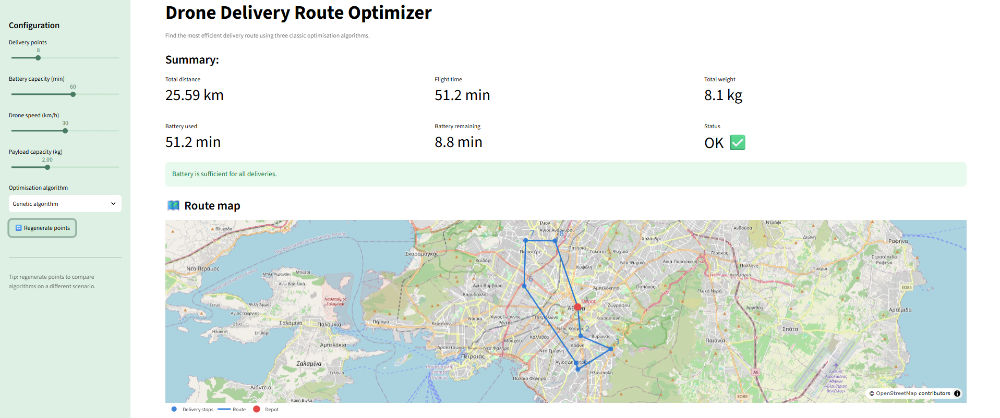
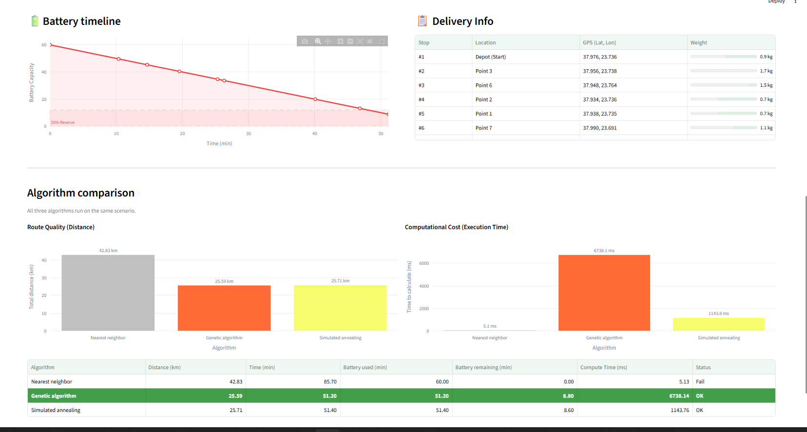

# 🚁 Drone Route Optimizer

A web app based on streamlit framework that visualizes and compares three routing algorithms (Nearest Neighbor, Genetic Algorithm, Simulated Annealing) to solve the Traveling Salesperson Problem (TSP) applied to drone delivery operations. 

## 🛠️ Features
 **Dynamic Scenarios:** Customize the number of delivery points, battery capacity, drone speed, and payload limits to generate unique scenarios.  
  **Interactive Mapping:** Visualize the optimized routes.  
   **Battery Timeline Tracker & Visualization:** Monitor the drone's battery consumption across the route to alert if the battery is depleted.  
    **Algorithm Comparison:** Run three algorithms concurrently on the same randomly generated dataset to evaluate performance based on total distance, time delivery and compute time. 

## 📁 Project-Structure

```text
drone-route-optimizer/
├── .streamlit/
│   └── config.toml
├── main.py             # Builds streamlit dashboard and visual layers.
├── algorithms.py       # Contains Nearest Neighbor, GA, and SA algorithms.
├── utils.py            # Includes data generation, distance calculation and metrics functions.
├── requirements.txt    # Dependency list
├── README.md           
└── .gitignore          
```

## ⚙️ Installation & Setup
### Create the virtual environment (optional but recommended):  
```bash
python -m venv venv
```
### Activate it:
- **Windows (Powershell):**
```bash 
.\venv\Scripts\Activate.ps1  
```
- **Linux/MacOS:**  
```bash  
source venv/bin/activate
```

### 📦 Install the dependencies:  
```bash
pip install -r requirements.txt
```
### 🚀 Run the app:
 ```powershell
streamlit run main.py
```


